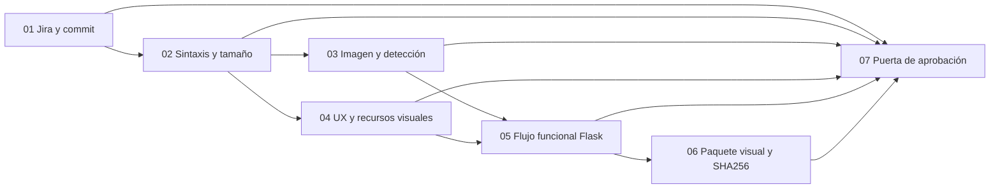

# Pipeline CI de Michelle Montoya Rocca

## Objetivo

El pipeline valida cada cambio enviado a `main` y cada pull request hacia esa rama. Relaciona el commit con una historia `SCRUM-n`, comprueba la calidad técnica y las funciones del MVP, y conserva evidencia descargable. La verificación del sitio publicado se ejecuta manualmente **después** del despliegue, para no confundir una compilación exitosa con una versión efectivamente instalada.

Además del CI general, hay dos workflows por dominio que se activan cuando cambian sus archivos o de forma manual:

| Workflow | Historias vinculadas | Prueba concreta |
|---|---|---|
| [Historias de visión](../../.github/workflows/historias_vision_michelle.yml) | SCRUM-10, 11, 12, 13 | Formato de carga, recuadro YOLO simulado, ausencia de hallazgos y nombres para SIGIA. Cuatro trabajos paralelos y una puerta final. |
| [Cuentas y planes](../../.github/workflows/cuentas_planes_michelle.yml) | SCRUM-84, 90 | Registro, sesión, permisos, cuotas y aislamiento. Dos trabajos paralelos y una puerta final. |

Los tests de seguridad invocados en el workflow de cuentas fueron escritos por Favio; ejecutarlos aquí comprueba una integración de Michelle, pero no cambia su autoría. Los commits de Michelle para SCRUM-10 a SCRUM-13, SCRUM-84 y SCRUM-90 ya existen en el historial y conservan su fecha original. Estos workflows nuevos aportan **evidencia actual de regresión**; no crean ejecuciones retrospectivas en la fecha de esos commits.

## Flujo de siete etapas



| Etapa | Qué comprueba | Evidencia en GitHub Actions |
|---|---|---|
| 01 Jira y commit | SHA, autor, fecha y clave Jira del commit. Los commits directos deben incluir `SCRUM-n`. | `michelle-01-trazabilidad` |
| 02 Sintaxis y tamaño | Compilación Python, sintaxis de todos los JavaScript y ausencia de archivos rastreados mayores de 25 MiB. | `michelle-02-calidad` |
| 03 Imagen y detección | Carga JPEG, validación de imagen, correspondencia YOLO–SIGIA, respuesta sin plaga y recuadros con confianza. | `michelle-03-unitarias` |
| 04 UX y recursos visuales | Rutas públicas, medios servidos, etiquetas accesibles y criterios de historias de UX. | `michelle-04-experiencia` |
| 05 Flujo funcional Flask | Registro, sesiones, clasificación y detección simuladas, permisos, planes y exportación privada. | `michelle-05-integracion` |
| 06 Paquete visual y SHA256 | Empaquetado de plantillas y recursos estáticos, con hashes verificados. No incluye pesos ni datos de usuarios. | `michelle-06-paquete-visual` |
| 07 Puerta de aprobación | Rechaza el run si cualquiera de las etapas anteriores falla o se omite. | Tabla en el resumen del run |

La [verificación del sitio](../../.github/workflows/verificacion_despliegue_michelle.yml) es otro workflow, activado manualmente tras publicar. Prueba HTTPS y seis páginas públicas, genera `sitio-publicado.json` y no requiere contraseñas. Sus dos trabajos separan la comprobación del resultado final. No despliega código ni afirma que el sitio corresponda al SHA del run.

## Alcance y límites de la evidencia

El repositorio no distribuye los pesos de YOLO ni ResNet. En CI, el smoke test usa respuestas simuladas para verificar el contrato HTTP y el flujo de la aplicación; **no mide precisión del modelo**. La seguridad avanzada y la prueba de navegador real pertenecen al [pipeline compartido de Favio](../../.github/workflows/favio-ci-seguridad.yml), que se ejecuta por separado. El empaquetado visual es un artefacto de revisión, no un instalador de producción.

Para presentar una contribución individual se muestra el run de GitHub Actions, la tabla de la puerta de aprobación y los artefactos. El archivo de trazabilidad permite cotejar la clave `SCRUM-n`, el SHA y la fecha con la historia de Jira. El pipeline no modifica estados ni fechas de Jira.

## Ejecución local

Desde la raíz del repositorio:

```text
python mvp/ci/check_repository_size.py
python mvp/ci/build_frontend_artifact.py
python -m unittest discover -s mvp/tests -p test_visual_experience.py -v
python mvp/smoke_test.py
python mvp/ci/check_deployed_site.py --base-url https://esparragos.comextech.es
```

Para el burndown, el avance se registra en Jira con las transiciones y fechas reales. El Sprint Review debe explicar cambios de alcance y trabajo terminado fuera del intervalo planificado; no se alteran fechas retrospectivamente para ajustar la curva.
